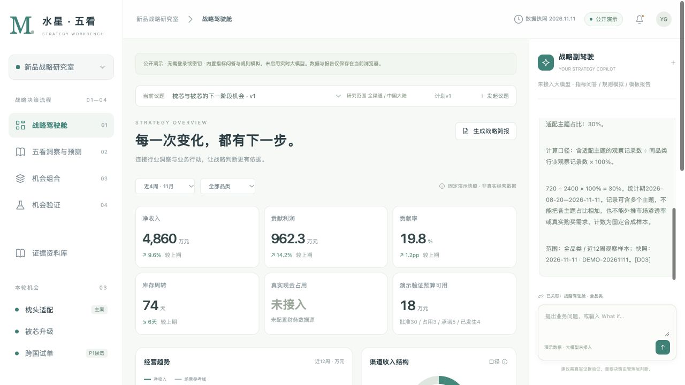

# 水星五看工作台

面向家纺行业管理层、市场研究、战略规划与产品企划团队的智能副驾驶产品Demo。采用行业、客户、竞争、自己与机会五个视角，串联经营监测、机会比较和验证条件。

**[打开在线演示](https://chloegao7376.github.io/mercury-five-lenses-workbench/)** · [部署与能力说明](docs/DEPLOYMENT.md)

公开演示通过GitHub Pages提供，无需GitHub或ChatGPT账号，无需填写API key。所有经营、需求与模拟数据均为合成演示，固定快照为2026-11-11，不代表水星家纺真实经营或当前市场事实。本项目为独立产品原型，不代表企业官方产品。



## 可体验的工作流程

1. **战略驾驶舱**：切换品类和周期，查看收入、贡献、库存及尚未接入的数据，点击“查看口径”核对公式与周表。
2. **五看洞察与预测**：查看行业、客户、竞品、品牌声量、自己与机会的演示信号，解释样本计数和统计边界，生成研究报告。
3. **机会组合**：调整预算、售价、成本、需求与退货率，比较增长、均衡和现金三种组合，查看研发、迭代与市场投放建议草案。
4. **机会验证**：编辑Brief，冻结实验条件，查看模拟结果及单位经济性。成本、质量或正式审批缺失时保持阻断，预检不产生有效业务批准。
5. **报告与证据**：在本浏览器保存版本化报告，导出HTML或Markdown，检查支持、反证及证据失效影响。
6. **Agent Harness**：查看内置Skill、只读工具、任务执行记录与模型边界，试运行已注册工具。

建议从驾驶舱点击“生成战略简报”，然后追问“适配主题占比30%如何计算？”，再进入机会组合输入“预算300万，成本上涨10%，需求下降15%，优先保护现金”。

## 公开版的能力边界

| 能力 | GitHub Pages公开演示 | 本地服务端代码 |
|---|---|---|
| 页面、监测、What-if、经济性、验证规则 | 可运行 | 可运行 |
| 对话 | 指标问答、意图解析与规则模板，不是实时大模型 | 配置自己的服务端密钥后可启用DeepSeek |
| Skill及工具 | 浏览器内只读工具与任务规则 | 保留MCP服务端和受控远程MCP适配 |
| 状态、资料、报告 | 当前浏览器本地保存 | 本地服务可持久保存 |
| 分享 | 分享此演示网址；报告导出文件分享 | 编号报告依赖独立部署的身份和存储 |
| 企业数据、团队权限、正式审批 | 未接入 | 仍需独立建设与验证 |

公开网页没有付费模型请求，也不向模型发送提问。开放域问题会明确提示能力限制。页面导入内容和笔记只在当前浏览器处理，不应输入内部资料。清除浏览器站点数据会清除本地工作区，请提前导出需要保留的报告。

需求响应模型为三个独立岭回归，使用180条合成训练样本与60条留出样本。模拟结果不代表真实预测准确率或投资收益。高级真实预测关闭。旧版缺乏计算底稿的需求指数128.6已停用，改用可说明分子分母的合成记录统计。

## 本地运行

需要Node.js 22或更高版本，无第三方运行依赖。

```bash
npm run build
npm start
```

打开 `http://127.0.0.1:4173`。本地服务仅监听本机，提供HTTP API与MCP。也可双击构建后的 `standalone/水星五看工作台.html`，离线体验浏览器模式。

```bash
npm run build:pages
npm test
```

公开网页构建到 `dist/pages/`，所有应用资源内联，不依赖仓库根目录路径，可在项目子路径下使用。推送 `main` 后，GitHub Actions自动检查并发布至GitHub Pages。

## 可选真实模型接入

公开演示不启用真实模型。希望在本机体验DeepSeek时，复制 `.env.example` 为 `.env`，仅在本机文件中配置自己的 `MODEL_TOKEN` 及DeepSeek相关参数，然后：

```bash
npm run build
node --env-file=.env scripts/serve.mjs
```

模型仅接收当前问题、服务端最近对话、内置模拟指标及工具结果，不发送上传资料、私有笔记或自定义Skill。密钥必须留在服务端，不能写入HTML、浏览器脚本、Pages配置或版本库。请勿把本地服务直接暴露为匿名公共模型接口。

## 代码结构

```text
public/                 页面、样式与交互
src/core.mjs            演示数据、指标口径、模拟与浏览器harness
src/workflow.mjs        共享业务规则、经济性与验证条件
src/deepseek.mjs        可选的服务端模型适配
src/service.mjs         服务端工作区、报告与异步任务
src/worker.mjs          HTTP与MCP接口
skills/                 可导入的Skill样例
scripts/                构建与本地启动
tests/                  业务与服务端检查
.github/workflows/      自动检查与Pages部署
```

本仓库只发布应用源码、合成演示数据及部署说明，不包含API密钥、原站点账号数据、内部PRD或私有报告。公开版V1.2.0，发布配置更新于2026-11-15。
